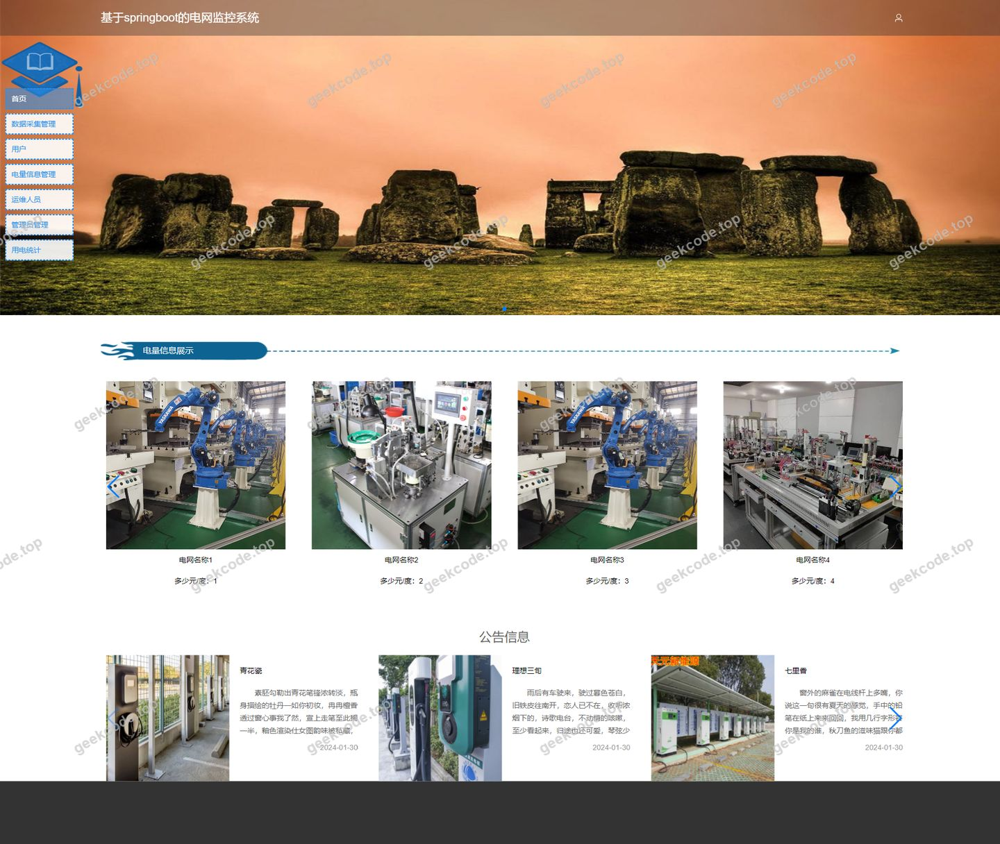
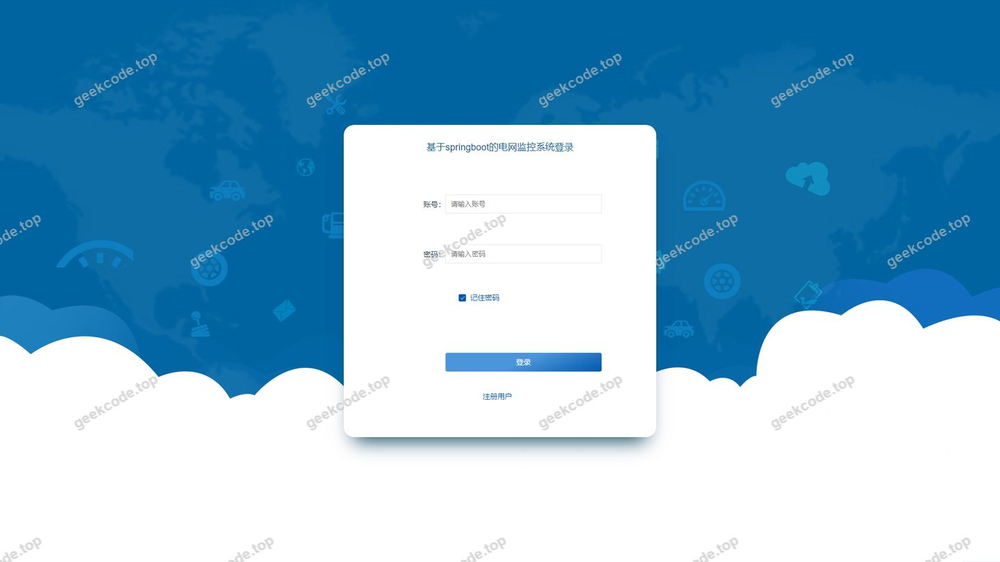
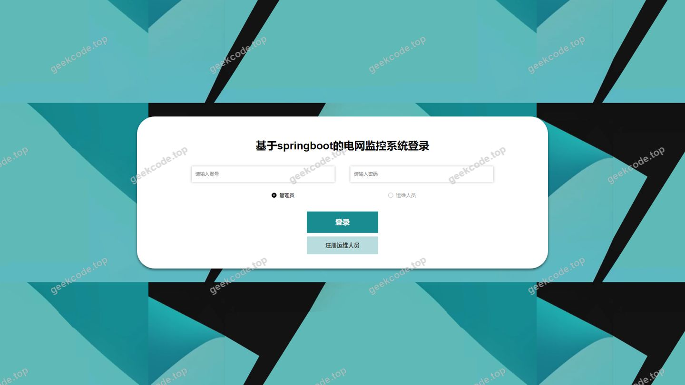
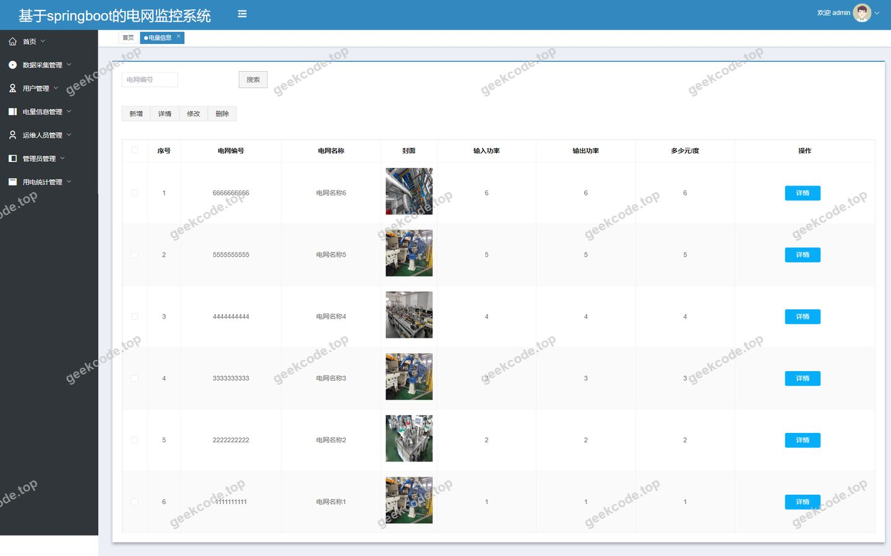
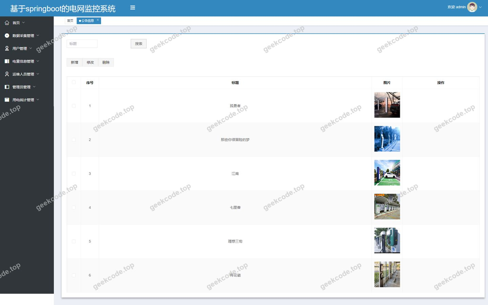
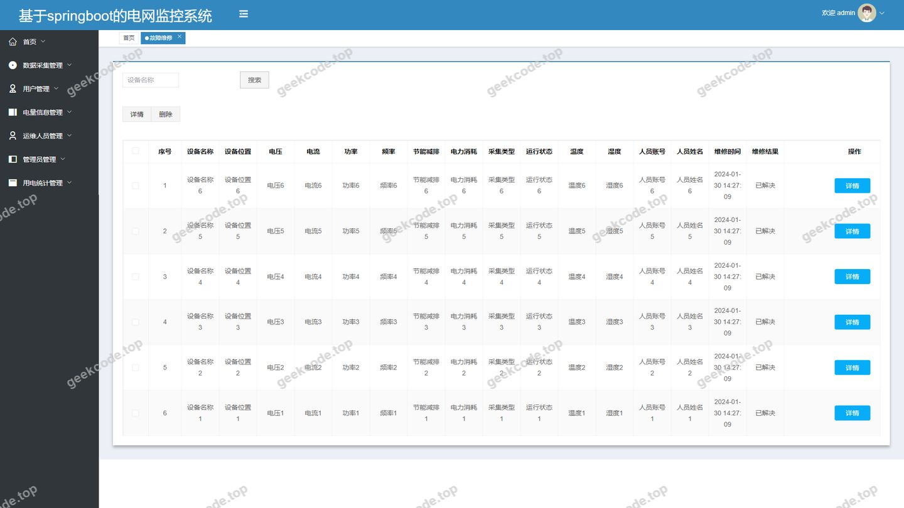
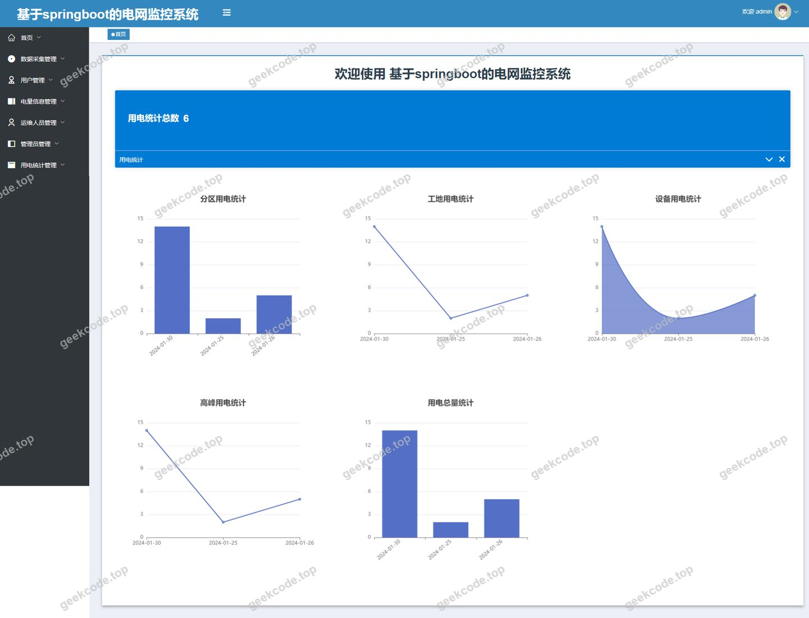
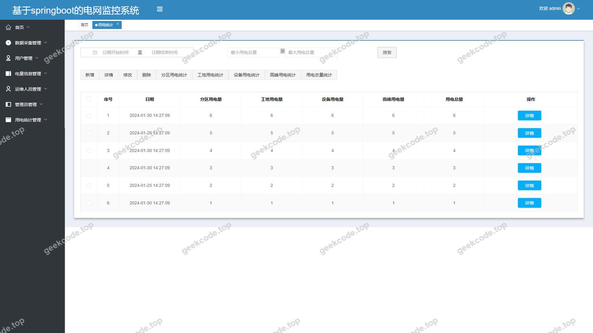
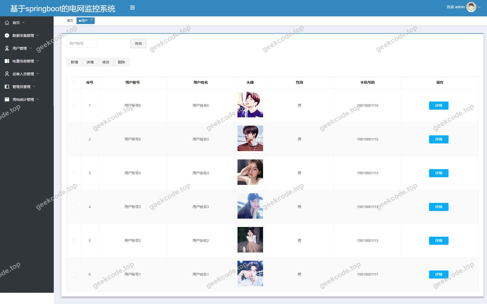
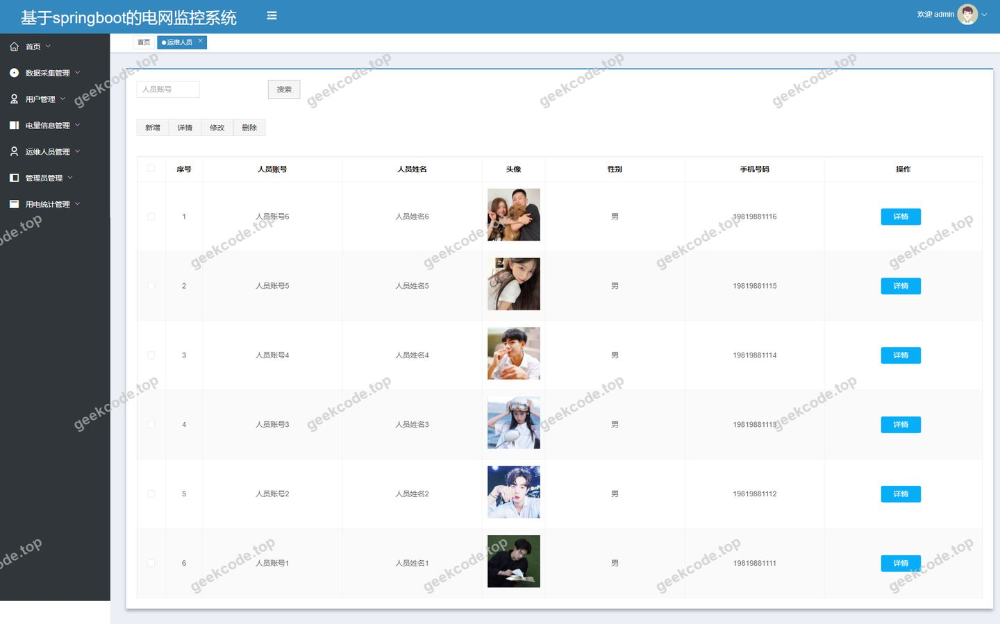

# 基于springboot的电网监控系统

> 🎓 **计算机毕业设计 · 基于springboot的电网监控系统**
>
> 本仓库只放**项目介绍 + 运行截图**（截图是站点带水印的原图，存在仓库 `images/` 里）。
>
> 👉 **完整可运行源码 / 数据库脚本 / 部署文档：[点我获取](https://geekcode.top/archives/%E5%9F%BA%E4%BA%8Espringboot%E7%9A%84%E7%94%B5%E7%BD%91%E7%9B%91%E6%8E%A7%E7%B3%BB%E7%BB%9F?utm_source=github)**
>
> 💬 咨询微信：**ir9372**　|　🌐 更多项目：[极客代码 geekcode.top](https://geekcode.top/?utm_source=github)
>
> 📌 项目详情页：<https://geekcode.top/archives/%E5%9F%BA%E4%BA%8Espringboot%E7%9A%84%E7%94%B5%E7%BD%91%E7%9B%91%E6%8E%A7%E7%B3%BB%E7%BB%9F?utm_source=github>

<table><td width="230" align="center"> <b>扫码加微信 ir9372</b></td><td valign="middle">📦 源码 = 项目介绍 + 全部运行截图 + 数据库 + 部署文档 👉 点上方任意截图，直接跳到 <b>极客代码 geekcode.top</b> 详情页</td></table>

---

<h1>基于springboot的电网监控系统</h1>
<h2>项目概述</h2>

本项目为基于 Spring Boot 的电网监控系统，旨在实现电力运维数据的数字化管理与实时监控。系统采用前后端分离架构，涵盖前台用户服务与后台管理功能。核心业务模块包括数据采集、实时监测、故障诊断、预警管理、维修记录及用电统计等。适用人群主要为电网运维人员、系统管理员及普通用电用户。通过整合 Shiro 权限控制与 MyBatis-Plus 数据持久化技术，系统实现了高效的数据交互与安全的管理机制，解决了传统电网管理中信息分散、响应滞后及数据统计困难的问题，提升了电力运维的智能化水平与管理效率。

<h2>技术架构</h2>
<h3>后端架构</h3>

系统后端基于 Java 语言开发，核心框架选用 Spring Boot，利用其自动配置特性简化部署流程。数据访问层采用 MyBatis-Plus 作为 ORM 框架，结合 MySQL 数据库进行数据存储，支持复杂查询与分页处理。安全认证与授权模块集成 Apache Shiro，实现细粒度的权限控制与会话管理。通信协议方面引入 protobuf-java 以优化数据传输性能，同时使用 commons-lang3 提供通用工具类支持。

<h3>前端架构</h3>

前端采用 Vue.js 框架构建单页应用（SPA），通过 vue-integrated 模式与后端接口对接。界面设计分为前台展示区与后台管理区，分别服务于普通用户与管理员/运维人员。前端路由独立配置，确保页面切换流畅且状态保持清晰。

<h3>数据库设计要点</h3>

数据库设计遵循第三范式，主要实体表包括：用户表、运维人员表、电量信息表、故障维修表、用电统计表、公告信息表、数据采集表、数据监测表、故障诊断表、故障预警表及购电记录表。各表之间通过外键关联，确保数据的一致性与完整性。例如，“故障维修”表关联“故障诊断”结果，“用电统计”汇总“电量信息”数据。

<h3>核心技术选型理由</h3>
<ol>
<li><strong>Spring Boot</strong>：提供快速启动能力与丰富的生态插件，降低配置复杂度。</li>
<li><strong>MyBatis-Plus</strong>：在保留 SQL 灵活性的基础上，大幅减少 CRUD 代码量，提升开发效率。</li>
<li><strong>Shiro</strong>：轻量级安全框架，适合中小型系统的权限管理需求，易于集成与维护。</li>
<li><strong>Vue.js</strong>：组件化开发模式便于复用 UI 元素，双向绑定机制简化了数据视图同步逻辑。</li>
</ol>
<h2>功能模块</h2>

根据源码路由与截图信息，系统功能划分为前台用户端与后台管理端两大板块。

<h3>前台用户端功能</h3>

前台主要面向注册用户与运维人员，提供信息查询与业务办理入口。

<ol>
<li>
<strong>用户中心模块</strong>

<ul>
<li><strong>用户列表与详情</strong>：查看个人基本信息及账户状态。</li>
<li><strong>用户注册与信息维护</strong>：新用户注册及个人资料的修改与保存。</li>
<li><strong>个人中心</strong>：集成用户相关的快捷操作入口。</li>
</ul>
</li>
<li>
<strong>运维人员模块</strong>

<ul>
<li><strong>运维人员列表与详情</strong>：展示运维团队信息及职责范围。</li>
<li><strong>运维人员注册</strong>：新运维人员的入驻申请与信息录入。</li>
</ul>
</li>
<li>
<strong>电力业务监控模块</strong>

<ul>
<li><strong>数据采集管理</strong>：查看原始采集数据列表、详情及新增录入。</li>
<li><strong>数据监测管理</strong>：实时监控电网运行指标，支持列表浏览、详情查看及数据添加。</li>
<li><strong>故障诊断管理</strong>：查看系统生成的故障诊断报告，支持历史查询与新诊断任务创建。</li>
<li><strong>故障预警管理</strong>：接收并查看潜在风险预警信息，支持预警记录的新增与详情查阅。</li>
<li><strong>故障维修管理</strong>：跟踪维修工单状态，查看维修记录详情及发起新的维修请求。</li>
</ul>
</li>
<li>
<strong>用电服务模块</strong>

<ul>
<li><strong>电量信息管理</strong>：查询当前及历史电量使用情况，支持详情查看与信息更新。</li>
<li><strong>购电管理</strong>：执行在线购电操作，查看购电订单列表及详情。</li>
<li><strong>用电统计</strong>：查看个人或区域用电量的统计分析图表及数据列表。</li>
</ul>
</li>
<li>
<strong>资讯模块</strong>

<ul>
<li><strong>新闻公告</strong>：浏览最新发布的行业新闻或系统通知。</li>
</ul>
</li>
</ol>
<h3>后台管理端功能</h3>

后台主要面向超级管理员，提供全局数据管理与系统配置功能。

<ol>
<li>
<strong>基础信息管理</strong>

<ul>
<li><strong>用户管理</strong>：对前台注册用户进行增删改查及状态控制。</li>
<li><strong>运维人员管理</strong>：审核及管理运维人员档案，包含注册信息的后台确认。</li>
<li><strong>公告信息管理</strong>：发布、编辑及删除前台展示的新闻或通知内容。</li>
</ul>
</li>
<li>
<strong>核心业务数据管理</strong>

<ul>
<li><strong>电量信息管理</strong>：集中管理所有用户的电量数据记录。</li>
<li><strong>故障维修管理</strong>：统筹调度维修资源，查看所有维修工单进度。</li>
<li><strong>用电统计管理</strong>：生成全系统维度的用电报表与统计数据。</li>
<li><strong>数据采集管理</strong>：监控底层设备上报的数据源状态。</li>
<li><strong>数据监测管理</strong>：查看全网实时监测数据流。</li>
<li><strong>故障诊断管理</strong>：审核系统自动诊断结果，必要时人工干预。</li>
<li><strong>故障预警管理</strong>：配置预警规则阈值，查看触发的预警事件。</li>
<li><strong>购电管理</strong>：处理所有用户的购电交易记录。</li>
</ul>
</li>
<li>
<strong>系统配置</strong>

<ul>
<li><strong>参数配置</strong>：管理系统运行所需的基础配置项。</li>
<li><strong>登录鉴权</strong>：后台管理员登录及安全会话管理。</li>
</ul>
</li>
</ol>
<h2>用户角色与权限</h2>

系统依据 Shiro 权限框架划分角色，不同角色拥有特定的功能访问权限。

<h3>1. 超级管理员 (Admin)</h3>

<em>对应后台路由 <code>/config</code>, <code>/yonghu</code> 等</em>

<ul>
<li><strong>权限描述</strong>：拥有系统最高权限，可访问后台所有管理模块。</li>
<li><strong>具体功能</strong>：<ul>
<li>管理用户账号（创建、禁用、重置密码）。</li>
<li>管理运维人员档案及注册审批。</li>
<li>发布和维护新闻公告。</li>
<li>全面管理电量、故障、监测、采集等业务数据。</li>
<li>查看全局用电统计报表。</li>
<li>配置系统参数。</li>
</ul>
</li>
</ul>
<h3>2. 运维人员 (Yunweirenyuan)</h3>

<em>对应前台路由 <code>/index/yunweirenyuan*</code>, <code>/index/shuju*</code>, <code>/index/guzhang*</code></em>

<ul>
<li><strong>权限描述</strong>：具备专业数据处理能力，主要负责电网运行状态的监控与维护。</li>
<li><strong>具体功能</strong>：<ul>
<li>登录前台系统，查看个人信息。</li>
<li>执行数据采集任务的录入与查看。</li>
<li>实时监控数据监测信息，发现异常。</li>
<li>处理故障诊断报告，确认故障原因。</li>
<li>接收并处理故障预警，发起或跟进故障维修流程。</li>
<li>查看相关电量信息与统计，辅助运维决策。</li>
</ul>
</li>
</ul>
<h3>3. 普通用户 (Yonghu)</h3>

<em>对应前台路由 <code>/index/yonghu*</code>, <code>/index/dianliangxinxi*</code>, <code>/index/yongdiangoumai*</code></em>

<ul>
<li><strong>权限描述</strong>：电力服务的消费者，主要关注自身用电情况与服务办理。</li>
<li><strong>具体功能</strong>：<ul>
<li>注册与登录，维护个人资料。</li>
<li>查询个人电量信息详情。</li>
<li>执行在线购电操作，查看购电记录。</li>
<li>查看个人用电统计概览。</li>
<li>浏览新闻公告。</li>
<li><em>注：根据现有路由结构，普通用户在前台似乎无法直接访问故障诊断与维修的高级管理功能，主要聚焦于消费侧数据。</em></li>
</ul>
</li>
</ul>
<h2>项目特色与创新点</h2>
<ol>
<li><strong>全链路闭环管理</strong>：系统覆盖了从“数据采集”到“数据监测”，再到“故障诊断”、“故障预警”以及最终的“故障维修”全过程，形成了完整的电网运维业务闭环，消除了信息孤岛。</li>
<li><strong>多维度的权限隔离</strong>：通过 Shiro 框架实现了前台用户、运维人员与后台管理员的严格权限分离。运维人员专注于技术层面的数据监控与维修调度，而普通用户仅能访问与其利益相关的电量与购电服务，保障了数据安全与业务边界清晰。</li>
<li><strong>实时性与统计结合</strong>：不仅提供实时的“数据监测”与“故障预警”功能，还集成了“用电统计”模块，将瞬时数据转化为长期趋势分析，为电力调度与用户节能提供了数据支撑。</li>
<li><strong>前后端一体化体验</strong>：采用 Vue 集成模式，使得前台用户界面与后台管理界面在技术栈上保持一致，降低了维护成本，同时提供了流畅的单页应用交互体验。</li>
</ol>
<h2>部署环境</h2>

为确保系统正常运行，需准备以下软件环境：

<ol>
<li><strong>Java 运行环境</strong>：JDK 1.8 及以上版本。</li>
<li><strong>数据库</strong>：MySQL 5.7 或 MySQL 8.0，需安装 JDBC 驱动。</li>
<li><strong>构建工具</strong>：Maven 3.6+，用于依赖管理与项目打包。</li>
<li><strong>前端环境</strong>：Node.js 12+，npm 或 yarn 包管理器，用于编译 Vue 前端代码。</li>
<li><strong>Web 服务器</strong>：内置 Tomcat（由 Spring Boot 提供）或独立的 Nginx/Apache 用于静态资源托管与反向代理。</li>
<li><strong>操作系统</strong>：Windows Server, Linux (CentOS/Ubuntu), 或 macOS。</li>
</ol>
<h2>五、技术特性</h2>
<ul>
<li>前后端集成部署，前端资源打包至后端 static 目录</li>
<li>使用 MyBatis-Plus 简化数据访问层开发</li>
<li>集成 Shiro 权限框架实现角色权限控制</li>
</ul>
<h2>六、功能模块截图</h2>
<h3>前台用户端</h3>
<h4>前台-首页</h4>

<h4>前台-登录</h4>

<h4>前台-用户注册</h4>

<h3>后台管理端</h3>
<h4>后台-登录页</h4>

<h4>后台-电量信息</h4>

<h4>后台-公告信息</h4>

<h4>后台-故障维修</h4>

<h4>后台首页</h4>

<h4>后台-用电统计</h4>

<h4>后台-用户</h4>

<h4>后台-运维人员</h4>

---

## 获取完整源码

| 项目 | 说明 |
| --- | --- |
| 项目名 | 基于springboot的电网监控系统 |
| 运行截图 | 本文 11 张（站点带水印原图，仓库 `images/` 目录） |
| 完整源码 | [https://geekcode.top/archives/%E5%9F%BA%E4%BA%8Espringboot%E7%9A%84%E7%94%B5%E7%BD%91%E7%9B%91%E6%8E%A7%E7%B3%BB%E7%BB%9F?utm_source=github](https://geekcode.top/archives/%E5%9F%BA%E4%BA%8Espringboot%E7%9A%84%E7%94%B5%E7%BD%91%E7%9B%91%E6%8E%A7%E7%B3%BB%E7%BB%9F?utm_source=github) |
| 咨询微信 | **ir9372**（备注：jingpin-yuanma） |
| 更多项目 | [极客代码 geekcode.top](https://geekcode.top/?utm_source=github) |

> 需要源码、部署、改配置、跑不起来等问题，加微信 ir9372 沟通，说明项目名即可。
